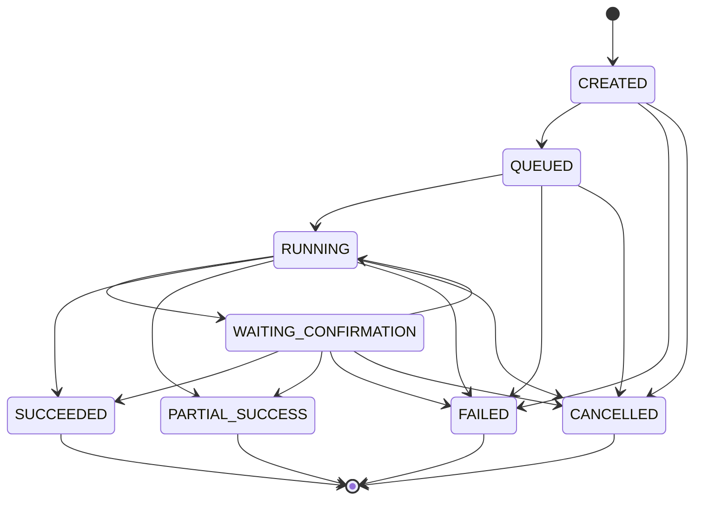

# 任务状态机

## 统一状态

所有订单解析、方案生成、重规划和评测任务使用同一组状态：

```text
CREATED
QUEUED
RUNNING
WAITING_CONFIRMATION
SUCCEEDED
PARTIAL_SUCCESS
FAILED
CANCELLED
```

## 状态迁移



## 迁移规则

- 创建任务时在同一事务中写入 `CREATED` 和 `QUEUED` 事件。
- 进度范围为 0 到 100，且不得回退。
- 非终态任务可以在状态不变时推进阶段和进度。
- 每次合法迁移都追加一个持久化 `TaskEvent`。
- `SUCCEEDED`、`PARTIAL_SUCCESS`、`FAILED`、`CANCELLED` 为终态。
- 终态任务不能重启；重试必须创建带 `retryOfTaskId` 的新任务。
- 取消订单解析时同步取消仍在处理的文档；取消规划时同步取消仍在生成的
  方案。
- 重启后只重派 `QUEUED` 或显式可重试阶段；不安全的 `RUNNING` 任务转为
  `TASK_RECOVERY_UNSAFE`。
- `PARTIAL_SUCCESS` 必须包含可用结果和明确的 `degradedComponents`。
- 自动冲突修复只允许一次 `LOCAL_REPLAN`，并创建新方案版本。

## 规划阶段

```text
QUEUED
REQUIREMENTS_LOADED
RESEARCH_READY
AGENTS_RUNNING
CANDIDATES_ASSEMBLED
RULE_VALIDATION
LOCAL_REPLAN
COMPLETED
```

## 订单解析投影

| 任务状态               | 文档状态       |
| ---------------------- | -------------- |
| `QUEUED`               | `QUEUED`       |
| `RUNNING`              | `PARSING`      |
| `WAITING_CONFIRMATION` | `NEEDS_REVIEW` |
| `SUCCEEDED`            | `PARSED`       |
| `FAILED`               | `FAILED`       |
| `CANCELLED`            | `CANCELLED`    |

## SSE 回放

公开 SSE `id` 使用事件 UUID，内部 `sequence` 用于排序：

1. 校验任务存在。
2. 在该任务内解析 `Last-Event-ID`。
3. 查询更大 sequence 的事件。
4. 按升序回放。
5. 非终态任务继续注册实时连接。

未知或已淘汰的事件 ID 返回 `TASK_EVENT_GONE` 和 HTTP 410。Redis 只保存
热缓存；PostgreSQL 序列保证断线恢复正确性。终态 SSE 的任务 ID、阶段和
进度必须与轮询结果一致。
