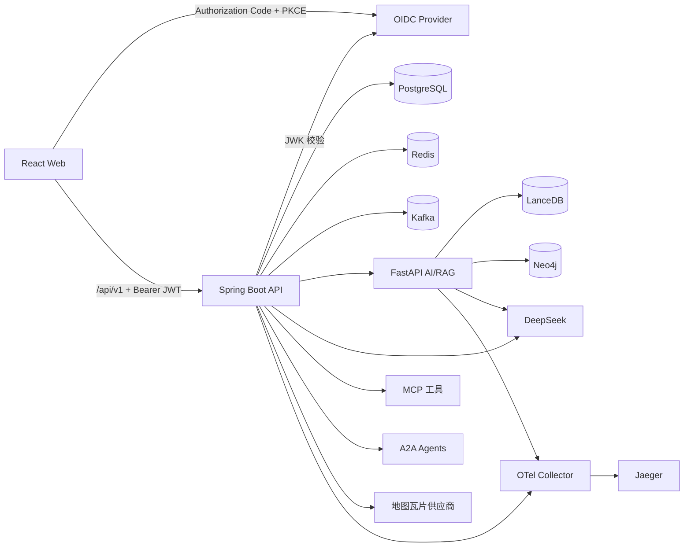
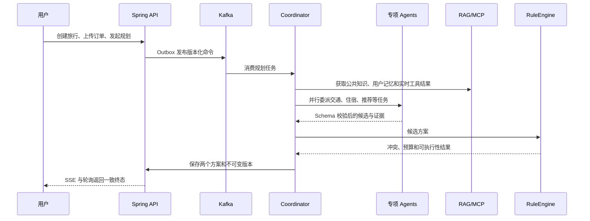

# TripAgent Nexus 总体架构

## 1. 目标

TripAgent Nexus 将语义理解和候选生成交给模型，将金额、日期、时间窗、
距离、状态和支付边界交给确定性的后端代码。系统采用 Contract First，
所有浏览器请求只进入 Spring Boot，FastAPI、模型、检索、MCP 和第三方
供应商均位于私有后端边界。

## 2. 运行拓扑



### 服务职责

- `trip-agent-api`：鉴权边界、幂等、领域状态、任务、Agent 编排、规则引擎、
  HITL、地图瓦片代理和公共 API。
- `ai-retrieval-service`：OCR、多模态解析、查询分析、LanceDB、Neo4j、
  GraphRAG 和重排。
- PostgreSQL：业务事实、任务、Outbox/Inbox、死信、审计和评测结果的唯一
  权威数据源。
- Redis：任务与 SSE 热缓存、会话投影、热点地点、限流和分布式锁；故障时
  不得替代 PostgreSQL。
- Kafka：至少一次异步投递；消费者依靠 Inbox 和业务幂等消除重复副作用。

## 3. 模块边界

```text
controller        HTTP 参数、状态码和版本边界
application       用例编排、事务和任务状态
domain            不依赖框架的领域对象与约束
agent             八个独立 Agent 与 A2A 协作
skill             MCP 工具目录、鉴权和工具实现
guardrail         输入、输出、外部域名、PII 与 HITL
observability     Trace、指标和敏感字段约束
integration       Kafka、模型、FastAPI 和外部适配器
infrastructure    配置、JPA、Redis 和文件存储
evaluation        数据集、回放器和指标聚合
```

Controller 不承载 Agent Prompt、规则或供应商逻辑。每个 Agent 拥有独立
类、输入输出 DTO、Prompt 版本、策略和 JSON Schema。

### 身份与资源授权

- 除健康检查、系统状态、地图瓦片及独立后端凭据保护的运维接口外，公共 API
  默认要求 Bearer JWT。Spring Security 使用配置的 JWK 集校验签名、issuer、
  audience、有效期和 UUID `sub`，业务代码不接受用户自报身份头作为认证依据。
- `sub` 是用户资源归属的唯一身份来源，`roles` 仅映射为服务端权限；
  `ResourceAuthorizationService` 在读取或修改旅行、方案、资料、任务、反馈、
  偏好和工作台投影前校验归属。跨用户资源统一按不存在返回，避免枚举。
- 浏览器采用 OIDC Authorization Code + PKCE。授权状态、Token 和 PKCE 临时数据
  仅保存在 `sessionStorage`，API 客户端和文件上传统一注入 Bearer Token；Token
  失效或用户变化时清除当前会话及本地旅行恢复索引。
- 生产和共享环境必须保持前后端认证开启。`USER_AUTH_ENABLED=false` 与
  `VITE_USER_AUTH_ENABLED=false` 只允许在显式隔离的本机演示和自动化测试中使用。

## 4. 规划链路



初始生成至少提供 `BALANCED` 和 `LOW_TRANSIT` 两种策略。自动修复最多
执行一次，并创建后继版本；原始冲突版本不修改。用户重规划可以锁定或
移除条目、调整预算和节奏，并保留触发原因与差异摘要。

### 结果页一致性

- 结果页以路由中的 `planId` 为唯一查询边界，地图、时间线、预算、冲突和
  证据只从同一个 `TravelPlan` 投影派生。
- 候选方案列表按 `tripId` 查询，版本比较按
  `(previousPlanId, currentPlanId)` 独立缓存，切换方案时不会复用前一版本
  的明细。
- 地图只接受 `Place.latitude/longitude`，推荐链路缺少坐标时保持空值，
  浏览器不进行地理编码或坐标猜测。
- 当前旅行和方案保存到本地恢复索引；刷新后仍需重新读取服务端方案事实，
  本地状态不替代服务端数据。
- 重规划创建后继版本，候选确认不触发交易；涉及费用的动作必须经过独立
  人工确认并核对金额、币种、风险、有效期和影响范围。

## 5. Agent 与上下文

八个 Agent：

1. `RequirementAgent`
2. `ResearchAgent`
3. `TransportAgent`
4. `AccommodationAgent`
5. `RecommendationAgent`
6. `BudgetAgent`
7. `ReviewAgent`
8. `CoordinatorAgent`

`ContextEnvelope` 包含系统规则、用户约束、已确认订单、检索证据、工具
结果、前序 Agent 结果、计划版本、Token 预算和隐私标签。投递前按职责和
隐私标签裁剪；硬约束和已确认订单不会仅因 Token 预算被删除。

## 6. RAG 与 GraphRAG

- 公共知识和用户记忆使用独立 LanceDB 表。
- 用户记忆必须以可信 `tenantId + userId` 在召回前过滤，并在结果包装前
  再校验。
- 查询链路依次执行改写、意图路由、地点/日期过滤、向量与关键词召回、
  图扩展、融合、Cross-Encoder 重排、去重和压缩。
- Neo4j 只保存带来源的图投影，模型不得创建不存在的证据 ID。
- 过期内容在重排前排除；无证据时返回 `evidenceInsufficient=true`。

## 7. MCP 与 A2A

MCP 使用官方 Java SDK 和 Streamable HTTP，提供八个严格 Schema 工具。
Bearer 身份、Agent 身份和 Skill 白名单均默认拒绝。真实供应商未配置时
返回 `UNAVAILABLE`，Mock 返回必须带 `providerMode=MOCK`。客户端固定 MCP
服务名称和版本，拒绝重复工具名、manifest 漂移及不符合本地输出 Schema 的结果；
工具文本按不可信内容处理。

A2A 使用官方 Java SDK。每次委派创建独立任务和 Span，结果统一包含
`taskId`、`agentName`、`status`、`result`、`evidence`、`warnings` 和
`traceId`。当前处理器同进程部署，但逻辑和契约保持独立。执行 checkpoint 绑定
任务、租户、输入、Prompt 版本和执行令牌，并通过 PostgreSQL 锁实现完成结果重放
与并发重复 claim 去重。

## 8. 异步与恢复

- 写操作先在 PostgreSQL 事务中保存业务数据与 Outbox。
- 事件携带 `eventId`、版本、因果链、`traceId`、`taskId` 和幂等键。
- Inbox 以 `(consumerName, eventId)` 去重。
- Kafka、模型、外部 HTTP 和 A2A 重试均有最大次数、超时和最大退避。
- 耗尽后进入持久化死信，不进行无限重试。
- 重启只重派安全的排队或显式可重试阶段；不安全的运行中步骤失败为
  `TASK_RECOVERY_UNSAFE`。

## 9. SSE 与轮询

任务事件先写 PostgreSQL，再广播 SSE 并缓存到 Redis。公开 SSE `id` 为
事件 UUID，内部 `sequence` 保证顺序。断线时用 `Last-Event-ID` 回放后续
事件；Redis 丢失不会造成永久进度缺口。终态 SSE 的 `taskId`、阶段和进度
必须与轮询接口的任务终态一致。

规划任务通过 `/api/v1/tasks/{taskId}/agents` 暴露逐 Agent 的安全执行投影。
该投影只包含状态、耗时、摘要、证据数量和警告，不返回完整 Prompt、模型
原文或跨 Agent 私有上下文。

## 10. Guardrails 与 HITL

- Prompt Injection、上传格式、文件签名、像素/页数、外部 HTTPS 域名、
  模型 JSON Schema、不可信检索内容和 PII 均在后端检查。
- 地图瓦片坐标、缩放级别、响应 MIME 和字节数由 Spring Boot 校验；前端
  只通过 generated `MapsApi` 访问后端代理，不直接连接瓦片供应商。
- 订单创建、支付、退订和真实成本动作只能先生成候选。
- 确认必须匹配动作 ID、Actor、版本、风险说明、金额、币种和过期时间。
- 过期状态和审计使用独立事务持久化，失败请求不能回滚过期事实。
- 真正供应商适配器必须在副作用前调用精确的执行授权检查。
- 用户界面只展示业务化状态和恢复建议，不直接展示 HTTP 状态码、运行模式、
  内部资源标识、链路标识、协议名称或服务端原始异常。完整诊断上下文只进入
  受控日志和 Trace。

## 11. 可观测性

OpenTelemetry 覆盖 HTTP、Kafka、模型、RAG、重排、Agent、MCP、A2A、
数据库和规则校验。记录延迟、状态、错误类型、模型、Prompt 版本、Token、
结果数、Agent 和工具名。

Trace 和日志禁止包含 API Key、Authorization、原始证件号、完整订单号、
原始图片、OCR 原文、完整 Prompt/模型输出和未脱敏私人偏好。

### 受控诊断投影

- 开发者追踪仅在开发工具显式启用且已验证 JWT 含 `ADMIN` 角色时访问；
  客户端自报角色不参与生产授权。
- Spring Boot 从 Jaeger 读取链路后，将节点归类为模型、知识检索、Agent、
  MCP、A2A 和 Kafka；Prompt、授权字段、密钥字段和用户属性统一脱敏。
- 系统状态只返回业务化依赖名称和可用状态，不返回主机、端口、连接串、
  密钥或内部异常。
- 普通页面不显示链路标识；开发者页面只接受显式查询并展示脱敏结果。

## 12. 用户偏好与反馈闭环

- 行程工作台按当前用户聚合旅行、订单资料、方案和异步任务，只返回继续任务
  所需的安全投影。
- 用户偏好区分主动设置和模型推断。推断偏好可拒绝；用户修改推断内容后，
  来源转为主动设置。
- 删除或拒绝偏好时，Spring Boot 必须先调用内部 AI 服务，按
  `tenantId + userId + preferenceId` 清理 LanceDB 记忆；清理失败则业务
  事务回滚。
- 反馈可指向方案、地点、预算和推荐依据。只有具备态度、原因标签且目标为
  方案或地点的反馈，才允许形成可拒绝的推断偏好。
- 评论、标签和偏好内容在持久化前均经过输入防护；预算和证据反馈不会自动
  写入长期记忆。

## 13. 接口冻结

当前公共契约位于 `packages/api-contract/openapi.yaml`，
`contracts/openapi/tripagent-v1.yaml` 保留为兼容性基线：

- 版本固定为 `1.0.0`，路径固定为 `/api/v1`。
- 已冻结路径、操作和字段不得删除或改名。
- 新字段必须为可选字段。
- 受保护操作继承 `BearerAuth`，仅明确公开或使用独立后端凭据的操作覆盖该要求。
- 稳定错误码必须写入 `docs/错误码.md`。
- TypeScript SDK 只允许从当前公共契约生成，并通过兼容性基线检查。

## 14. 部署与降级

Mock 必须显式配置并在响应、日志和评测环境中标记。真实模式只从服务端
环境读取 `DEEPSEEK_API_KEY`。天气、路线、汇率、营业时间和交易供应商未配置时
失败关闭，不得以 Mock 结果伪装真实成功。

生产前端由 Nginx 提供静态资源，并将 `/api/` 同源代理到 Spring Boot。
前端镜像不注入模型密钥或第三方服务凭据；浏览器仍只访问公共 `/api/v1`
边界。OIDC authority、客户端 ID 和 scope 在前端构建时配置；issuer、audience
和 JWK 集只在后端运行时配置。占位身份地址会失败关闭。Compose 中 `web` 必须
等待 `trip-agent-api` 健康后启动。
