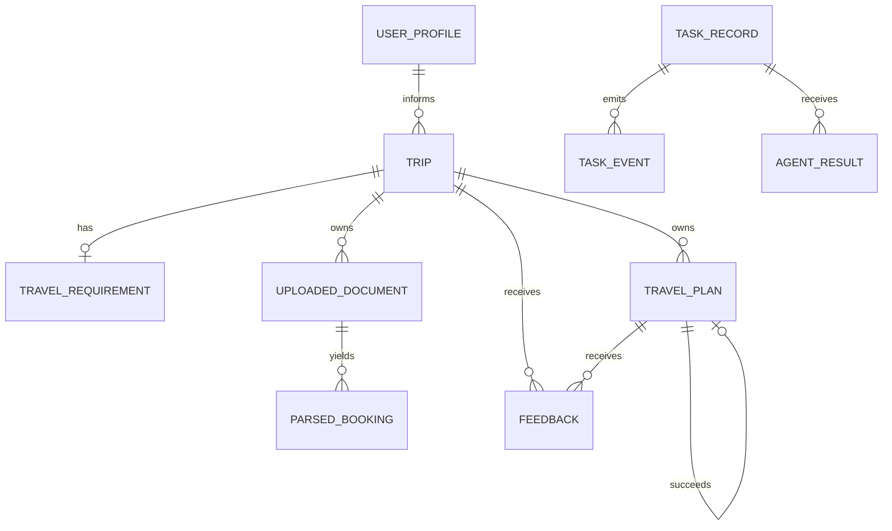

# TripAgent Nexus 领域模型

## 1. 通用约定

- ID 使用 UUID。
- 持久化时间戳使用 UTC：Java `Instant`、PostgreSQL `TIMESTAMPTZ`。
- 行程日历日期使用 `LocalDate` 和 PostgreSQL `DATE`。
- 旅行保存 IANA `timeZone`，用于本地展示和时间窗解释。
- 金额使用 `BigDecimal` 和 `NUMERIC(19,4)`，禁止使用 `double`/`float`。
- 币种使用大写 ISO 4217。
- 客户端集合均有长度上限，不以逗号字符串持久化。
- PostgreSQL 是业务事实源；JSONB 只保存有明确类型的聚合快照。

## 2. 聚合关系



## 3. 核心对象

### UserProfile

记录用户节奏、兴趣、饮食、住宿、交通和预算习惯。数据归用户所有，不复制
到公共知识库。

### Trip

旅行项目根，包含 `tripId`、`userId`、标题、时区、状态和可选需求。
保存合法需求后从 `DRAFT` 进入 `READY`。

### TravelRequirement

包含出发地、目的地、起止日期、旅客、总预算、币种、兴趣、节奏、
必去/避开地点和自由文本约束。必须满足：

- `endDate >= startDate`
- `totalBudget >= 0`
- 至少一个目的地和一个旅客

### ParsedBooking

订单类型包括 `FLIGHT`、`HOTEL`、`TICKET`、`TRAIN`、`OTHER`。保存供应商、
地点、交通号、入住信息、时间、人数、金额、币种、置信度、缺失字段、
字段证据、规则问题和人工修正审计。

上传文件存放于仅 Owner 可访问的存储目录，数据库只保存不透明存储键和
SHA-256。`(trip_id, sha256)` 唯一约束防止重复解析。

### TravelPlan

主要字段：

- `planId`、`planFamilyId`、`tripId`、`previousPlanId`
- `alternativeKey`、`strategy`、`version`
- `days`、`budgetSummary`、`conflicts`、`evidence`
- `triggerReason`、`replanInput`、`changeSummary`
- `autoReplanned`、`status`、创建/更新时间

初始候选拥有不同 `planFamilyId`。重规划生成新的 `planId` 和递增版本，
通过 `previousPlanId` 指向前一版本，历史版本不可覆盖。

### DayPlan 与 ItineraryItem

`DayPlan` 保存日期、序号、标题和有序行程项。`ItineraryItem` 保存类型、
标题、描述、UTC 时间窗、地点、金额、币种和证据 ID。

### BudgetSummary

保存预算上限、估算总额、剩余额度、分类明细和每日预算。所有计算由 Java
使用 `BigDecimal` 完成。

### Conflict 与 Evidence

`Conflict` 保存稳定规则码、类型、严重级别、字段路径、相关行程项、
自动修复资格和解决状态。`Evidence` 保存来源类型、来源 ID、标题、摘要、
可选 URL 和检索时间。

### TaskRecord 与 TaskEvent

任务类型包括订单解析、方案生成、重规划和评测回放。任务保存状态、阶段、
进度、`traceId`、结果资源、失败码、是否可重试、恢复次数、降级组件和
重试链路。

统一状态：

```text
CREATED
QUEUED
RUNNING
WAITING_CONFIRMATION
SUCCEEDED
PARTIAL_SUCCESS
FAILED
CANCELLED
```

`TaskEvent` 保存事件 UUID、任务 ID、阶段、进度、消息和时间；数据库
`sequence` 只用于可靠排序和 SSE 断点续传。

### AgentExecution

`AgentExecution` 是规划任务下逐 Agent 执行状态的安全投影，包含 Agent 名称、
状态、用户可读摘要、耗时、证据数量、警告以及起止时间。底层复用
`agent_result` 表，只保存最小必要摘要，不持久化完整 Prompt、模型原文或
用户上下文。未开始的 Agent 状态由后端根据任务事实投影为 `QUEUED`，终态
任务中未执行的 Agent 投影为 `SKIPPED`。

### EventInbox、Outbox 与 DeadLetterEvent

- Outbox 与业务写入处于同一事务。
- Inbox 以 `(consumerName, eventId)` 建立消费幂等边界。
- Dead Letter 保存原事件、主题、因果链、安全失败原因和重放信息。
- 重放创建新任务，原失败任务保持不可变。

### GuardedAction

动作类型为 `ORDER_CREATE`、`PAYMENT`、`CANCELLATION`、`REAL_COST`。
候选保存风险说明、精确金额、币种、过期时间、Actor、乐观锁版本和审计。
确认和执行分离；执行必须再次校验动作、资源、类型、金额、币种、状态和
有效期。

### EvaluationRun

保存数据集版本、运行状态、样本数、聚合指标、运行环境和案例结果。
案例结果记录预期、观察值、通过状态、延迟、Token 和失败信息，不编造
供应商数据。

### RetrievalChunk

LanceDB 使用 `travel_public` 和 `user_memory` 两张物理表。公共和用户块均
保存来源、地点、有效期、语言、正文、向量、更新时间和元数据；用户记忆
额外保存 `tenantId`、`userId`。

### TravelKnowledgeGraph

Neo4j 节点类型为 `City`、`Region`、`Attraction`、`Restaurant`、`Hotel`、
`Station`、`Airport`、`TransitLine`。关系限制为 `LOCATED_IN`、`NEAR`、
`CONNECTED_TO`、`OPEN_DURING`、`SUITABLE_FOR`、`CONFLICTS_WITH` 和
`REQUIRES_RESERVATION`。

### ContextEnvelope

每次 Agent 调用的不可变最小上下文，包含系统规则、用户约束、确认订单、
证据、工具结果、Agent 结果、计划版本、Token 预算和隐私标签。发送前按
责任和隐私裁剪。

## 4. 幂等

每个写操作按 `(operation, Idempotency-Key)` 唯一：

- 相同键和相同请求返回原响应。
- 相同键和不同请求返回 `IDEMPOTENCY_KEY_REUSED`。
- 失败事务不留下占位记录。
- PostgreSQL `ON CONFLICT DO NOTHING` 防止并发重复资源。

## 5. 迁移

- `V1`：平台健康标记。
- `V2`：旅行、需求、方案、任务和反馈。
- `V3`：订单解析、人工修正和 Outbox。
- `V4`：Agent 与 MCP 行程制品。
- `V5`：方案家族、版本链和变更元数据。
- `V6`：Inbox、死信、恢复和重试链路。
- `V7`：Guarded Action、审计和评测运行。

LanceDB 和 Neo4j 是可重建的派生索引，不是业务事实源。
